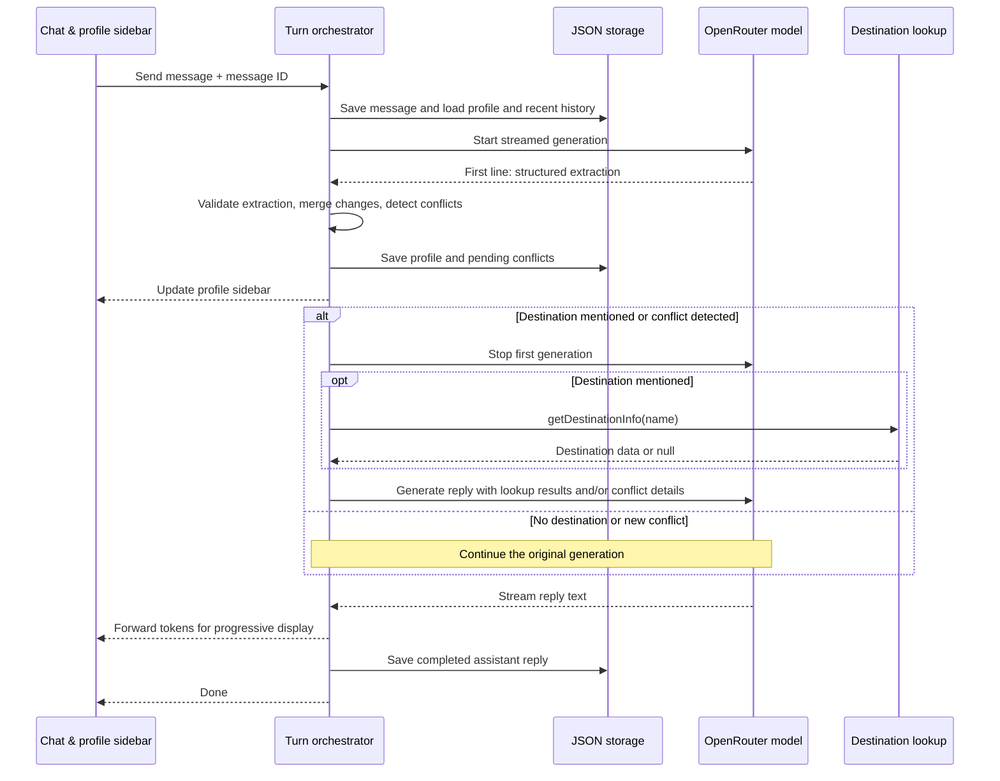

# Travel Profile Builder

A single-page travel companion that learns your preferences through conversation. Chat about your preferences while a read-only sidebar builds a persistent travel profile. Assistant replies stream into the chat, and profile changes appear before the reply when extraction succeeds.

Built with Next.js 16, React 19, TypeScript, Zod, and OpenRouter. The app assumes one user and runs locally with JSON-file storage.

## Quick start

You need Node.js **20.9 or newer**, npm, and an [OpenRouter API key](https://openrouter.ai/settings/keys). Installation and model requests require internet access.

From the repository root:

```bash
npm ci
cp .env.example .env.local
```

Set your key in `.env.local`:

```dotenv
OPENROUTER_API_KEY=your_openrouter_api_key
LLM_MODEL=nvidia/nemotron-3.5-lightning:free
LLM_FALLBACK_MODEL=inclusionai/ling-3.2-flash:free
```

Then start the app:

```bash
npm run dev
```

Open [http://localhost:3000](http://localhost:3000). No database setup or migrations are needed. `.env.local` and persisted data are gitignored; keep your API key server-side.

### Configuration

| Variable | Purpose | Default |
| --- | --- | --- |
| `OPENROUTER_API_KEY` | Required for model-backed chat | None |
| `LLM_MODEL` | Primary OpenRouter model ID | `nvidia/nemotron-3.5-lightning:free` |
| `LLM_FALLBACK_MODEL` | Backup OpenRouter model ID | `inclusionai/ling-3.2-flash:free` |
| `DATA_DIR` | Optional persistence directory | `data/` under the repository root |

Blank model variables use the defaults. To use another model, change its ID and restart the server. The provider endpoint is OpenRouter; switching to a different provider requires changing the LLM adapter. Model availability, free-tier quotas, and instruction-following vary. If a default model is unavailable to your account, configure another available OpenRouter model.

## Try the core flow

1. Say, “Call me John. I like food and prefer mid-range travel.” Watch the sidebar update.
2. Ask about **Kyoto**. The app looks up destination data and supplies it to a new reply generation for an informed follow-up.
3. Ask about an unknown destination such as **Atlantis**. When extracted, the lookup returns `null`, and the reply is instructed to acknowledge that it has no destination data.
4. Say, “I don't eat beef,” followed by “I eat beef sometimes.” A detected conflict keeps the stored restriction, shows a **needs confirmation** badge, and asks for clarification. Answer through chat to resolve it.
5. Reload the page. The profile, pending conflicts, and recent chat history are restored.

The hardcoded destination catalog contains **Kyoto, Lisbon, Reykjavik, Bali, Mexico City, and Cape Town**, with common aliases and case/diacritic normalization. Each entry has seasons, interests, daily budget estimates, and visa notes. The catalog uses illustrative sample data and is not maintained as current travel guidance.

## How it works

The diagram shows a successful turn. Extraction repair and other failure paths are described under **Failure behavior**.



### Streaming and extraction

The server supplies the current profile and last 20 stored messages to the model. A normal turn uses one streamed generation: the first line is a JSON extraction describing changes, destinations, and conflict resolutions; the remaining output is conversational prose.

The server validates the extraction with Zod and sends typed SSE events to the browser. The client validates those events and uses a small rendering buffer to smooth bursty token delivery. The opening greeting is static, so loading the page does not call the model.

If extraction names a destination or application code detects a conflict, the server stops the first generation after extraction. It runs `getDestinationInfo` and/or prepares the conflict details, then starts a reply-only generation with that information injected. This keeps ordinary turns to one call while accepting an additional call when grounding or clarification is needed. It does not use native LLM function calling or API-enforced structured output.

### Profile and conflicts

The profile has eight fields: display name, dietary restrictions, budget tier, interests, preferred seasons, travel companions, lodging style, and wishlist destinations. These support conversational personalization, destination-based follow-ups, and explicit conflict examples without introducing accounts.

Lists merge additively. Changes to existing budget, companions, or lodging values, and removals from stored dietary or seasonal preferences, create pending conflicts. The old value remains until the model extracts the user's resolution. Interests and wishlist destinations only grow; display name uses the latest value without confirmation. Conflict logic lives in one module, separate from prompting and UI rendering.

### Persistence and retries

The server stores `data/profile.json` and `data/messages.json`. Writes use a temporary file followed by rename; Zod validates data on load. Invalid or unreadable files are quarantined as `*.corrupt`, logged, and replaced with empty state on subsequent use. There is currently no user-facing reset notice.

JSON files avoid database installation for this single-user exercise. A `Store` interface leaves room for a database implementation later. Storage includes an in-process lock, with concurrency limitations described below.

The user message is saved before the model call. An assistant message is saved only after a complete reply; partial assistant replies are not persisted. A failed reply can still leave profile changes that were already saved. Retry reuses the message ID and avoids re-appending it when it is still the latest stored user message.

### API and source layout

| Endpoint | Contract |
| --- | --- |
| `POST /api/chat` | Accepts `{ messageId, text }`; returns SSE events: `tool`, `profile`, `conflict`, `token`, `warning`, `done`, or `error` |
| `GET /api/state` | Returns `{ profile, messages }` for restoration, including up to 100 recent messages |

Shared runtime schemas and TypeScript types live in `src/contract/`. Requests, model extraction, persisted data, and incoming client SSE events are validated at their boundaries.

```text
src/contract/       Shared schemas and interfaces
src/server/turn.ts Turn orchestration
src/server/llm/    OpenRouter adapter, prompts, stream parser
src/server/        Conflict logic, destination catalog, logging
src/server/store/ JSON persistence and locking
src/app/api/       Thin HTTP route handlers
src/components/    Chat and read-only profile view
src/hooks/         SSE consumption and client state
```

## Failure behavior

| Situation | Current behavior |
| --- | --- |
| Missing API key | The page and greeting still load. Sending a message returns `missing_credentials` without calling the model; no Retry button is shown. |
| Invalid key (`401`/`403`) | Returns `invalid_credentials`; does not try the backup with the same rejected key. |
| Rate limit, server error, or network failure before content | Tries the backup model once per generation; otherwise shows a retryable error. |
| Stream breaks after content begins | Shows an interruption error and allows retry; does not persist the partial assistant reply. |
| Malformed extraction | Makes one repair attempt, then continues with prose and an `extraction_failed` warning if extraction still fails. |
| Unknown extracted destination | Lookup returns `null`; the reply is instructed not to invent destination details. |
| Invalid request body | Returns HTTP `400` before a model call. |

The OpenRouter adapter has a 30-second idle timeout. Structured logs include request IDs, model, call latency, time to first content, and outcome; token usage is not collected.

## Verification

```bash
npm test
npm run lint
npm run build
npm run typecheck
```

Run the build before standalone typechecking on a clean checkout: Next.js generates route types used by the app. For production mode, run `npm run build` followed by `npm start`.

The current suite contains 33 targeted tests covering conflict merging/resolution, destination lookup, JSON storage, and incremental extraction parsing. Build and these tests passed during review. Manual testing also demonstrated profile updates, conflict confirmation, and an unknown-destination response. Automated live-provider and browser end-to-end tests are not included; both configured models have not been systematically benchmarked against the same scenarios.

## Known limitations and scope cuts

- **Extraction depends on model instructions.** A valid but incomplete extraction can miss a destination or implicit contradiction. List additions are not checked for semantic incompatibility.
- **Destination grounding is incomplete on degraded paths.** If extraction fails twice, prose continues without destination lookup. Destinations introduced by the assistant can also lack tool grounding. The application can therefore produce unsupported travel claims despite the grounded normal path.
- **Concurrent turns are not fully safe.** Assistant-message appends do not acquire the store lock, so overlapping requests can lose history updates. The lock is process-local, and profile/history writes are not a single transaction. Use one active conversation at a time.
- **Persistence requires a writable, durable filesystem.** This implementation targets a local server, not ephemeral or multiple-instance serverless hosting. Messages are stored in plaintext and are not pruned from disk.
- **Recovery is limited.** Retry deduplication checks only the latest message. Corrupt-file recovery logs a reset without notifying the user in the UI.
- **Scope is intentionally small.** No authentication, multiple users, real travel APIs, bookings, or clear-conversation control. Interests and wishlist entries cannot currently be removed through extraction. The UI targets desktop use.

## With another day

- Add orchestration tests for malformed extraction, destination grounding, conflicts, retries, and interrupted streams, plus a browser test for reload restoration.
- Close the destination-grounding gaps and serialize all history writes.
- Evaluate both models on the same extraction and contradiction examples.
- Improve recovery messaging before adding product features.
- For higher traffic, replace JSON files with transactional shared storage, add durable request deduplication and bounded concurrency, and use measured extraction accuracy, latency, and cost to choose models and prompting strategies.
